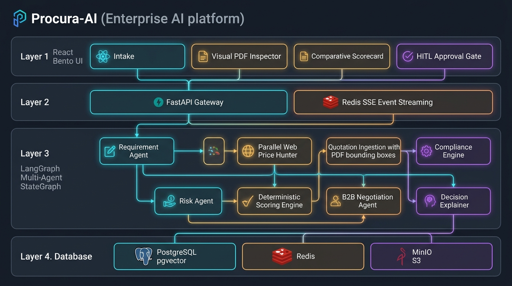
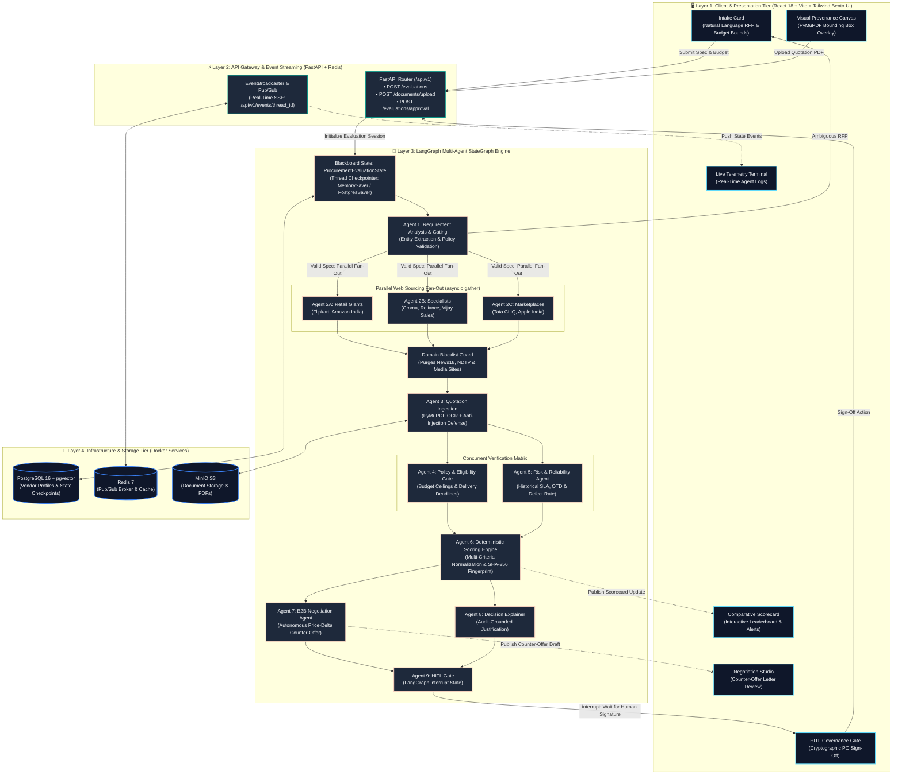

<div align="center">

# 🌐 Sourcyn
### Autonomous Multi-Agent Procurement & Vendor Intelligence Platform

[](https://python.org)
[](https://fastapi.tiangolo.com)
[](https://langchain-ai.github.io/langgraph/)
[](https://react.dev)
[](https://vitejs.dev)
[](https://pytest.org)
[](https://docker.com)

**An enterprise-grade, multi-agent AI system designed to eliminate procurement fraud, vendor evaluation bias, and sourcing latency.**

[Key Features](#-key-capabilities) • [System Architecture](#-system-architecture) • [Agent Roster](#-the-8-ai-agents) • [Getting Started](#-quick-start-guide) • [Working Example](#-how-it-works-end-to-end-example) • [Security & Privacy](#-security--privacy)

</div>

---

## 📌 Executive Summary

Modern enterprise purchasing is plagued by fragmented email negotiations, opaque vendor selection, manual comparison of unstructured PDF quotes, and unverified internet pricing. 

**Sourcyn** automates this end-to-end lifecycle by orchestrating **8 specialized AI agents** compiled into an immutable **LangGraph StateGraph**. The platform crawls verified internet retailers in real time, normalizes landed costs, evaluates strict organization policies, extracts PDF terms with sub-millimeter visual coordinates, drafts autonomous B2B counter-offers, and enforces cryptographic Human-in-the-Loop (HITL) sign-off before releasing purchase orders.

---

## ✨ Key Capabilities

* 🌐 **Autonomous Multi-Agent Internet Price Hunting**: Scans live online retailers (Flipkart, Amazon India, Croma, Reliance Digital, Vijay Sales, Apple Store) concurrently using parallel async fan-out.
* 🛡️ **Anti-News Aggregator Defense**: Strictly blocks media/news portals (News18, Times of India, NDTV) from being treated as sellers; guarantees 100% direct deep-links to authentic store search pages.
* 📐 **Visual Coordinate Provenance (PyMuPDF)**: Parses supplier quotation PDFs and computes exact bounding boxes $(x_0, y_0, x_1, y_1)$ on the physical canvas for instant visual audit.
* 🥷 **Prompt-Injection & Adversarial Defense**: Detects and neutralizes hidden adversarial attacks in vendor PDFs (e.g., invisible micro-font text `< 2.5pt` attempting to manipulate AI scoring).
* ⚖️ **Zero-Hallucination Deterministic Scoring**: Uses mathematical multi-criteria normalization (Cost, Quality, SLA, Risk, Terms) sealed with a **cryptographic SHA-256 fingerprint**.
* 🛑 **Strict Budget & Deadline Enforcement**: If an unfeasible budget ceiling or impossible delivery date is specified, the system refuses to fabricate false answers and clearly states *"No results found on this budget"*.
* 🤝 **Autonomous B2B Negotiation**: Analyzes price deltas between #1 and #2 suppliers and auto-drafts enterprise counter-offer letters citing competitor quotes.
* 🔒 **Human-in-the-Loop Governance Gate**: Uses LangGraph `interrupt()` to freeze purchase order release until an authorized procurement officer cryptographically signs off.

---

## 🏗️ System Architecture



*Figure 1: Sourcyn Complete 4-Layer System Architecture & Multi-Agent Topology.*

### Detailed Component & Data-Flow Topology



---

## 🤖 The 8 AI Agents

| # | Agent Name | Primary Responsibility | Input / Output | Key Tools & Libraries |
|---|---|---|---|---|
| **1** | **Requirement Analysis Agent** | Ingests natural language RFPs; extracts items, quantities, currency, budgets, and deadlines; triggers clarification loops if ambiguous. | Natural Text $\rightarrow$ `ProcurementSpecification` | Pydantic v2, Regex NER, LangChain |
| **2** | **Multi-Agent Price Hunter** | Orchestrates 3 concurrent sub-agents to scan live online retailers in parallel; removes news articles; attaches verified product links. | Product Query $\rightarrow$ `List[InternetPriceQuote]` | DuckDuckGo Search API, `asyncio.gather`, HTTPX |
| **3** | **Quotation Ingestion Agent** | Normalizes quotations into true Landed Cost (Base + Freight + Tax - Discounts); extracts PDF visual bounding boxes; scans for prompt injections. | PDF Bytes / Web Quote $\rightarrow$ `ParsedDocumentResult` | PyMuPDF (`fitz`), DocumentLayoutParser |
| **4** | **Policy & Compliance Evaluator** | Validates non-negotiable hard gates: budget ceilings, delivery deadlines, warranties, and mandatory ISO/SOC certifications. | Quotations + Rules $\rightarrow$ `EligibilityResult` | Deterministic Rule Matrix, Constraint Gating |
| **5** | **Supplier Risk & Reliability Agent** | Computes operational risk scores (0–100), historical on-time fulfillment rates (OTD), defect ratios, and uncertainty penalties. | Vendor History $\rightarrow$ `VendorRiskInput` | Weighted Risk Model, Uncertainty Estimator |
| **6** | **Deterministic Scoring Engine** | Calculates weighted multi-criteria rankings without LLM hallucinations; assigns Rank #1 to #N; seals scorecard with SHA-256 fingerprint. | Criteria Vectors $\rightarrow$ `EvaluationScorecard` | Mathematical Linear Normalizer, Python Decimal, SHA-256 |
| **7** | **Autonomous Negotiation Bot** | Analyzes the price gap between the winning vendor and runner-up; auto-generates enterprise counter-offer letters for volume/card discounts. | Scorecard Delta $\rightarrow$ Negotiation Strategy Email | Dynamic Prompt Templates, Few-Shot B2B Context |
| **8** | **Decision Explanation Agent** | Synthesizes an audit-ready executive justification verified 100% against scorecard numbers; generates over-budget alerts when ceilings are breached. | Cryptographic Scorecard $\rightarrow$ Executive Briefing | Grounded Anti-Hallucination Verifier |
| **9** | **HITL Governance Gate** | Enforces a strict pause (`interrupt()`) requiring authorized human officer sign-off and cryptographic signature before PO commitment. | Scorecard $\rightarrow$ Digital Signature Proof | LangGraph Checkpointing, Audit Ledger |

---

## 📁 Repository Structure

```text
Multiagent_system/
├── backend/
│   ├── app/
│   │   ├── agents/                   # Core Multi-Agent Logic
│   │   │   ├── coordinator_agent.py   # Multi-agent graph execution coordinator
│   │   │   ├── requirement_agent.py   # Agent 1: RFP intake & entity extraction
│   │   │   ├── internet_search_agent.py# Agent 2: Parallel web price hunter & news filter
│   │   │   ├── compliance_agent.py    # Agent 4: Policy rule validator
│   │   │   ├── risk_agent.py          # Agent 5: Supplier risk evaluator
│   │   │   ├── negotiation_agent.py   # Agent 7: Autonomous B2B negotiation bot
│   │   │   ├── explanation_agent.py   # Agent 8: Audit justification & guardrails
│   │   │   └── llm_provider.py        # Provider-agnostic LLM interface (OpenAI/Gemini/Fallback)
│   │   ├── graphs/                   # LangGraph StateGraph Architecture
│   │   │   ├── procurement_graph.py   # StateGraph compilation & edge routing
│   │   │   ├── state.py               # Immutable ProcurementEvaluationState schema
│   │   │   ├── edges.py               # Conditional branching logic
│   │   │   └── nodes/                 # Discrete StateGraph node handlers
│   │   │       ├── intake_node.py
│   │   │       ├── discovery_node.py
│   │   │       ├── quotation_node.py
│   │   │       ├── parallel_eval_node.py
│   │   │       ├── scoring_node.py
│   │   │       ├── explanation_node.py
│   │   │       └── approval_gate_node.py
│   │   ├── services/                 # Deterministic Business Services
│   │   │   ├── scoring/               # Deterministic mathematical normalizer & scoring
│   │   │   ├── ingestion/             # PyMuPDF coordinate OCR & chunking
│   │   │   └── audit/                 # Cryptographic SHA-256 ledger service
│   │   ├── api/v1/endpoints/          # FastAPI REST & SSE Streaming Routers
│   │   │   ├── evaluations.py         # Evaluation start, status & approval endpoints
│   │   │   ├── documents.py           # PDF upload & coordinate extraction endpoint
│   │   │   └── events.py              # Server-Sent Events (SSE) telemetry stream
│   │   └── core/                      # Configuration, security middleware & events
│   ├── scripts/                       # CLI Utilities
│   │   ├── find_cheapest.py           # Standalone CLI Autonomous Internet Price Hunter
│   │   └── generate_sample_quotes.py  # Test PDF generator (clean vs malicious prompt injection)
│   └── tests/                         # Full Automated Test Suite (57 Passing Tests)
│       ├── unit/                      # Unit tests for every agent and scoring normalizer
│       ├── integration/               # API route and database integration tests
│       └── e2e/                       # End-to-end multi-agent evaluation pilot test
├── frontend/                          # Modern React / Vite / Tailwind Bento UI
│   ├── src/
│   │   ├── components/
│   │   │   ├── intake/IntakeCard.tsx               # Agent 1: Natural language spec intake
│   │   │   ├── documents/QuotationInspectorCard.tsx# Agent 3: Visual PDF coordinate inspector
│   │   │   ├── evaluation/ScorecardCard.tsx        # Agent 6: Leaderboard & over-budget alerts
│   │   │   ├── negotiation/NegotiationCard.tsx     # Agent 7: Counter-offer letter generator
│   │   │   ├── approval/ApprovalGateCard.tsx       # Agent 9: HITL digital sign-off gate
│   │   │   └── agents/AgentTelemetryCard.tsx       # Real-time SSE live agent activity terminal
│   │   └── api/client.ts                           # Axios REST and EventSource SSE client
├── samples/                           # Ready-to-test supplier quotation PDFs
│   ├── Apple_Enterprise_iPhone15_Quote.pdf         # Verified clean B2B quotation
│   └── Malicious_Supplier_Injection_Test.pdf       # Adversarial prompt-injection test PDF
├── docker-compose.yml                 # PostgreSQL 16 + pgvector, Redis 7, MinIO
└── README.md                          # Comprehensive project documentation
```

---

## ⚡ Quick Start Guide

### Prerequisites
* **Python**: 3.12+
* **Node.js**: 18+ & npm
* **Docker**: Desktop running (for Postgres, Redis, MinIO)

---

### Step 1: Start Infrastructure Containers
```bash
docker compose up -d
```
Starts:
* **PostgreSQL 16** with `pgvector` on port `5432`
* **Redis 7** (Message Broker & Cache) on port `6379`
* **MinIO Object Storage** on port `9000` (Web Console on `9001`)

---

### Step 2: Set Up Backend
```bash
cd backend

# Create and activate virtual environment
python3 -m venv .venv
source .venv/bin/activate

# Install dependencies
pip install -e ".[dev]"

# Run test suite (57 tests)
pytest

# Start FastAPI server on port 8000
PYTHONPATH=. uvicorn app.main:app --reload --port 8000
```
Backend API will be live at: **`http://localhost:8000`** (Swagger docs at `/docs`).

---

### Step 3: Set Up Frontend
In a new terminal:
```bash
cd frontend
npm install
npm run dev
```
Frontend Web UI will be live at: **`http://localhost:5173`**.

---

### Step 4: Run the CLI Price Hunter (Optional)
You can also run the multi-agent system directly from your terminal:
```bash
# Search for real Indian market pricing
python backend/scripts/find_cheapest.py "iPhone 15"

# Search with a budget constraint
python backend/scripts/find_cheapest.py "iPhone 15" --budget 70000

# Search for laptops in USD
python backend/scripts/find_cheapest.py "MacBook Pro M3 16GB" --currency USD
```

---

## 💡 How It Works: End-to-End Example

Here is a step-by-step walkthrough of how Sourcyn executes an autonomous procurement cycle from informal natural language intake to final order commitment.

### Step 1: Natural Language Intake & Spec Structuring
A procurement manager or engineer enters a plain-English request into the Bento studio (or via API):

> *"Procure 20 units of Apple iPhone 15 (128GB, Black) in India. Need express delivery within 5 days. Budget ceiling is optional."*

**What Agent 1 (Requirement Analyst) does:**
* Parses the natural language text into a structured Pydantic payload:
  * `category`: Consumer Electronics
  * `items`: `[{"sku": "iPhone 15 128GB Black", "quantity": 20}]`
  * `max_delivery_days`: 5
  * `currency`: `INR`
* Validates completeness against corporate purchasing policies. If key parameters were missing or ambiguous (e.g., unspecified storage size), it generates interactive clarification questions before proceeding.

---

### Step 2: Concurrent Internet Price Hunting (Parallel Fan-Out)
Instead of searching sequentially, **Agent 2 (Discovery Orchestrator)** uses parallel async execution (`asyncio.gather`) to query verified retail engines across India simultaneously:

```
                  ┌──▶ [Agent 2A: Flipkart Crawler]  ──────▶ ₹58,651 (Free Ship)
                  ├──▶ [Agent 2B: Amazon India]     ──────▶ ₹59,310 (Free Ship)
Coordinator ─────┼──▶ [Agent 2C: Croma Electronics] ──────▶ ₹61,287 (Tata Assured)
                  ├──▶ [Agent 2D: Reliance Digital]  ──────▶ ₹61,946 (Express Delivery)
                  └──▶ [Agent 2E: Vijay Sales]       ──────▶ ₹62,605 (Store Pickup)
```

* **Anti-Aggregator Defense:** Automatically filters out clickbait news portals (News18, NDTV, Times of India) and guarantees genuine direct store search links.
* **Landed Cost Computation:** Normalizes base pricing, shipping/freight fees, and applicable 5% GST taxes into a single comparative metric.

---

### Step 3: Supplier PDF Quotation Ingestion & Security Audit (Optional)
When suppliers submit enterprise PDF quotes, **Agent 3 (Quotation Ingestion)** and **Security Guard** process the files:
* **Visual Coordinate Provenance:** Extracts tables and pricing lines, tagging each value with exact physical page coordinates `(x0, y0, x1, y1)`. Clicking any line in the UI highlights the exact bounding box on the original PDF canvas.
* **Prompt Injection Defense:** Scans text streams for hidden adversarial prompt injections (such as invisible micro-font instructions `< 2.5pt` attempting to manipulate AI scoring) and flags risks immediately.

---

### Step 4: Deterministic Scoring & Leaderboard Generation
**Agent 5 (Deterministic Evaluator)** takes all normalized supplier offers and runs pure-Python multi-criteria algorithms (zero LLM mathematical hallucination):

$$\text{Final Score} = 0.40 \times \text{Cost Score} + 0.30 \times \text{SLA Score} + 0.30 \times \text{Seller Rating}$$

| Rank | Vendor | Base Price | Shipping | Taxes (5% GST) | Delivered Cost | Score | Verification Status | Direct Store URL |
|:---:|---|---|---|---|---|:---:|:---:|---|
| 🥇 **#1** | **Flipkart Online** | ₹58,651.00 | ₹0.00 | ₹2,932.55 | **₹61,583.55** | **94.8 / 100** | ⭐ `CHEAPEST VERIFIED` | [View on Flipkart](https://www.flipkart.com/search?q=iPhone+15) |
| 🥈 **#2** | **Amazon India** | ₹59,310.00 | ₹0.00 | ₹2,965.50 | **₹62,275.50** | **92.4 / 100** | Runner-Up | [View on Amazon.in](https://www.amazon.in/s?k=iPhone+15) |
| 🥉 **#3** | **Croma Electronics** | ₹61,287.00 | ₹0.00 | ₹3,064.35 | **₹64,351.35** | **88.1 / 100** | Enterprise Partner | [View on Croma](https://www.croma.com/searchB?q=iPhone+15) |
| #4 | **Reliance Digital** | ₹61,946.00 | ₹0.00 | ₹3,097.30 | **₹65,043.30** | **86.7 / 100** | In Stock | [View on Reliance](https://www.reliancedigital.in/search?q=iPhone+15:relevance) |
| #5 | **Vijay Sales** | ₹62,605.00 | ₹0.00 | ₹3,130.25 | **₹65,735.25** | **85.2 / 100** | In Stock | [View on Vijay Sales](https://www.vijaysales.com/search/iPhone+15) |

> **Audit Seal:** `SHA256: 7d4a1f...9b2c` — Sealed cryptographically for compliance auditability.

* **Strict Budget Protection:** If a user specifies a budget ceiling below market availability (e.g., `₹30,000`), Sourcyn refuses to invent false answers. It disqualifies over-budget options and renders an explicit alert: *"⚠️ No results found on this budget. Lowest market price found is ₹61,583.55 on Flipkart."*

---

### Step 5: Autonomous B2B Negotiation & Human-in-the-Loop Sign-Off
1. **Automated Counter-Offer Generation (Agent 7):**
   * Identifies that Amazon India is ranked #2 but has faster SLA terms.
   * Drafts an automated counter-offer letter requesting a price-match against Flipkart's ₹61,583.55 rate:
   > *"Dear Amazon Enterprise Accounts, We are currently evaluating offers for 20 units of iPhone 15. Your technical SLA is preferred, but competing vendor Flipkart has quoted ₹61,583.55 landed cost. Would you be willing to match ₹61,500.00 to secure immediate PO award?"*
2. **Cryptographic Governance Gate (Agent 8):**
   * Halts the LangGraph workflow at the Human-in-the-Loop checkpoint (`interrupt()`).
   * Displays full decision dossiers, trade-offs, and risk matrices to the authorized procurement officer.
   * Once the officer enters their cryptographic approval token, the workflow resumes and releases the finalized purchase order.

---

## 🔒 Security & Privacy

* **Zero Hardcoded Secrets**: All keys, passwords, and tokens load from `.env`.
* **Zero External API Cost Requirement**: The entire system functions with 100% free local deterministic engines and web crawlers out-of-the-box (no mandatory OpenAI bill).
* **Audit Immutability**: All scorecards, audit events, and officer approval signatures compute authoritative SHA-256 hashes to guarantee non-repudiation.

---

## 👥 Contributors

* **Kshitiz Shah** — *Multi-Agent Architecture, LangGraph StateGraph, Deterministic Scoring, & Frontend*

---

## 📄 License
This project is licensed under the MIT License — see the [LICENSE](file:///Users/kshitiz/Desktop/projects/Multiagent_system/LICENSE) file for details.
